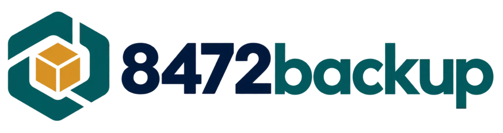

# 8472backup

  

A planned client/server backup system with client-side encryption, deduplication, and server-enforced retention. It is inspired by BorgBackup with borgmatic.

## 🚧 Project status

8472backup is in the early design and development phase. No usable backup implementation is available yet.

---

## 🔐 Protecting backup history

The server enforces a minimum protection period for committed snapshots. This is intended to protect existing backup history if a source client is compromised.

Backup data is encrypted on the client. The server stores and manages the encrypted data without holding the client's data decryption keys.

---

## 📦 Snapshots and storage

Backups create complete snapshots for a client's backup set. Deduplication allows snapshots to share stored objects. Objects are grouped into packs for physical storage.

---

## 🔄 Backup modes

- **Pull** is the default. The server schedules and connects to the client.
- **Push** lets the client initiate the backup.

Both modes use SSH and the same server-side retention and protection rules.

---

## 🛠️ Technology

8472backup uses Python 3.12 or later. External runtime dependencies must be available as Debian trixie packages. The project aims to keep dependencies small.

---

See [the project page](https://www.thk-systems.net/8472backup/) for details.
